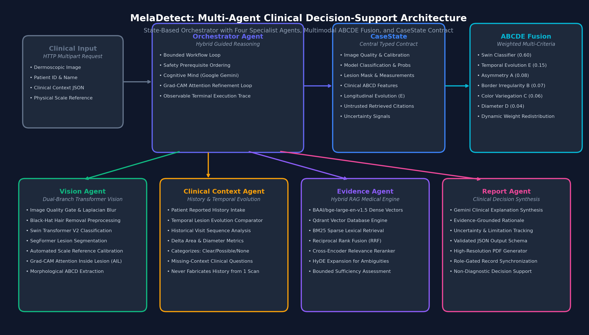

# Melanoma Detection

An agentic, retrieval-augmented framework for explainable melanoma analysis from dermoscopic images and supplied clinical context.

> **Disclaimer:** This is an AI-assisted research and decision-support system. It does **not** provide a definitive diagnosis and does not replace a qualified clinician. Do not use it for clinical decisions.

---

## Architecture



A state-based **Orchestrator** drives four specialist agents through a shared `CaseState`.

| Component | Role |
|---|---|
| `OrchestratorAgent` | Observes `CaseState`, chooses the next action, executes it, records a concise execution event, and reassesses until complete |
| `VisionAgent` | Image validation, preprocessing, SwinV2 classification, SegFormer segmentation, OpenCV/scikit-image measurements, calibration, Grad-CAM, and the authoritative image-derived ABCD observations. Classification and segmentation run as **parallel** branches |
| `ClinicalContextAgent` | Owns patient history and the ABCDE Evolution (E) criterion: records supplied history, assesses longitudinal evolution across image visits, and raises missing-information questions |
| `EvidenceAgent` | The only retrieval path. BGE embeddings + Qdrant + BM25 + RRF fusion + cross-encoder reranking + parent expansion + HyDE-capable queries, with bounded evidence-gap follow-up cycles |
| `ReportAgent` | Synthesizes results, explanation, and uncertainty into a validated JSON report, and renders a PDF when available |

**Clinical context safety:** the `ClinicalContextAgent` records supplied evolution/history and asks for what is missing, but **never infers patient history from a single image** — when no history is supplied, Evolution (E) stays `unavailable` and a clinical question is raised.

### Flow

```text
image / supplied context -> Orchestrator -> CaseState -> decide next tool
                                         -> Vision | Clinical Context | Evidence
                                         -> Orchestrator -> Report -> JSON / PDF
```

The Orchestrator is not a fixed phase sequence. Examples:

- Low classification confidence → requests a differential-evidence goal
- Evolution unavailable → raises a clinical question
- Evidence gap → targeted retrieval cycle, up to the configured maximum

### CaseState

`CaseState` (`src/agents/state.py`) is the central contract. It deliberately separates:

- model outputs
- raw pixel measurements
- calibrated physical measurements
- supplied clinical context
- untrusted retrieved evidence
- uncertainty
- the public execution trace

Pixel measurements are always `{unit: "pixels", calibrated: false}`. No millimetre threshold (e.g. the ABCD "D > 6 mm" criterion) is applied without valid scale calibration.

---

## Features

- Parallel SwinV2 classification and SegFormer segmentation
- Grad-CAM visual explanations
- Automated ABCD feature extraction (Asymmetry, Border, Color, Diameter), with Evolution supplied as clinical context
- Hybrid RAG over medical literature with reranking and gap-driven re-retrieval
- Uncertainty-aware reporting and explicit missing-information questions
- Validated JSON output and optional PDF report
- Operational execution trace (events only, no private chain-of-thought)
- Lazy evidence backend: image-only validation needs no Qdrant or LLM connection

---

## Project Structure

```text
.
├── main.py                     # Unified CLI entry point (serve, orchestrate, build-rag)
├── config.yaml                 # System, model, and orchestrator configuration
├── requirements.txt            # Python dependencies
├── package.json                # Project and frontend scripts
├── assets/
│   └── architecture.png        # Four-agent system architecture diagram
├── api/
│   ├── server.py               # FastAPI backend & WebSocket/streaming endpoints
│   ├── auth.py                 # User authentication & role-based access control
│   ├── admin.py                # Admin portal routes
│   └── schemas.py              # Pydantic request/response schemas
├── frontend-ui/                # React / Vite frontend application
│   ├── src/
│   │   ├── pages/              # Upload, Dashboard, PatientHistory, Reports, etc.
│   │   └── components/         # UI components & notification providers
├── rag_pipeline/               # Medical literature hybrid retrieval engine
│   ├── query_engine.py         # Dense vector + BM25 retrieval & RRF reranking
│   ├── create_vector_db.py     # Qdrant vector index builder
│   ├── reranker.py             # Cross-encoder reranker
│   └── cleaned_documents/      # Curated dermatology reference literature
├── src/
│   ├── agents/                 # Top-level multi-agent system
│   │   ├── orchestrator.py     # OrchestratorAgent (Hybrid Guided Reasoning loop)
│   │   ├── vision.py           # VisionAgent (dual-branch SwinV2 & SegFormer)
│   │   ├── clinical_context.py # ClinicalContextAgent (history & evolution)
│   │   ├── evidence.py         # EvidenceAgent (hybrid medical RAG retrieval)
│   │   ├── report.py           # ReportAgent (clinical synthesis & PDF rendering)
│   │   ├── abcde_fusion.py     # Multimodal ABCDE fusion engine
│   │   ├── explainability.py   # Gemini LLM clinical explanation service
│   │   └── state.py            # CaseState typed data contract
│   ├── classification/         # Swin Transformer V2 training & inference
│   ├── segmentation/           # SegFormer lesion boundary delineation
│   ├── features/               # Quantitative ABCD feature extractors
│   ├── engine/                 # Core diagnosis, scale calibration & quality check
│   └── evaluation/             # Metrics, validation & benchmark suites
└── tests/                      # Architectural, comparator & integration tests
```

---

## Setup

```bash
git clone https://github.com/ShivakarthikVuppala/MelanomaDetection.git
cd MelanomaDetection
python -m venv .venv
source .venv/bin/activate        # Windows: .venv\Scripts\activate
pip install -r requirements.txt
```

**Required before running:**

1. **Model checkpoints:** place the trained weights at the paths defined in `config.yaml`:
   - Classifier: `checkpoints/best_swin_checkpoint.pth` (Swin Transformer V2 base window12to16 192to256)
   - Segmentation: `checkpoints/best_segformer_melanoma.pth` (SegFormer mit_b2)
2. **RAG index:** build the medical vector database with:
```bash
   python main.py build-rag
```
3. **Environment:** configure environment variables in `.env` (image-only validation works without external services):
   - `GEMINI_API_KEY`: Google Gemini API key for clinical explanation synthesis and orchestrator cognitive deliberation.
   - `QDRANT_URL`: URL for the Qdrant vector database (defaults to in-memory local storage if omitted, or `http://localhost:6333`).
   - `QDRANT_API_KEY`: API key if connecting to a remote Qdrant Cloud cluster.
   - `MONGODB_URI`: MongoDB connection string for user accounts and patient records (defaults to `mongodb://localhost:27017`).

---

## Usage

### CLI

```bash
python main.py orchestrate path/to/image.jpg   # run the full agent workflow
python main.py serve                           # start the FastAPI server on port 8000
python -m pytest tests/                        # run test suite
```

### API

`POST /api/analyze` is the single canonical analysis endpoint (multipart form) hosted on `http://localhost:8000`.

| Field | Required | Description |
|---|---|---|
| `image` | yes | Dermoscopic lesion image file (JPEG, PNG) |
| `clinical_context_json` | no | JSON string containing patient clinical history and reported evolution |
| `patient_id` | no | Patient identifier string (enables longitudinal visit tracking across encounters) |
| `patient_name` | no | Patient full name (auto-filled on ID lookup) |
| `scale_method` | no | Calibration method: `auto` (default), `manual`, or `none` |
| `scale_reference_mm` | no | Reference dimension in millimeters if using manual calibration |

```bash
curl -X POST http://localhost:8000/api/analyze \
  -F "image=@path/to/image.jpg" \
  -F 'clinical_context_json={"evolution": {"reported_change": true, "timeframe_months": 3}}' \
  -F "patient_id=PT-2024-001"
```

**Response includes:**

- the validated report (classification, segmentation, measurements, ABCD observations, evidence references, explanation, uncertainty)
- `execution_trace`: operational events only
- `clinical_questions`: missing information the user should supply

---

## Data and Models

| Component | Architecture / Detail | Configuration |
|---|---|---|
| **Classifier** | Swin Transformer V2 (`swinv2_base_window12to16_192to256`) | Input: 256×256 px, 2 classes (melanoma, non_melanoma), classification threshold: 0.3775 (optimized via Youden's J for sensitivity ≥ 0.90 floor) |
| **Segmentation** | SegFormer (`mit_b2`) | Input: 256×256 px, morphological closing kernel: 5, binary lesion mask output |
| **Feature Extraction** | OpenCV & scikit-image morphometrics | Inertial principal-axis asymmetry (A), compactness & radial variance border irregularity (B), CIE Lab K-means color variegation (C), metric scale calibration (D) |
| **Temporal Evolution** | ClinicalContextAgent comparator | Cross-visit surface area delta, max diameter delta, and temporal progression categorization (`clear_evolution`, `possible_evolution`, `no_significant_evolution`) |
| **Multimodal Fusion** | ABCDEFusionScorer | Base weights: Classifier 0.60, Evolution 0.15, Asymmetry 0.08, Border 0.07, Color 0.06, Diameter 0.04 (dynamic reallocation when parameters uncalibrated) |
| **Retrieval Engine** | Hybrid RAG Pipeline | `BAAI/bge-large-en-v1.5` dense embeddings, Qdrant vector database, BM25 sparse index, Reciprocal Rank Fusion (RRF), Cross-Encoder reranker, HyDE query expansion |
| **Cognitive Reasoning** | Google Gemini (`gemini-3.8-flash` / `gemini-3.1-flash-lite`) | Evidence deliberation, clinical uncertainty evaluation, grounded explanation generation |
| **Training Data** | ISIC Archive Challenge Datasets | Preprocessed dermoscopic imagery with hair removal (black-hat morphology) and illumination normalization; partitioned into stratified train, validation, and held-out test splits |

### Evaluation Results

Evaluated across 15,579 held-out dermoscopic images with multimodal ABCDE fusion:

| Metric | Value | Detail |
|---|---|---|
| **Total Images Processed** | 15,579 | Full benchmark test set |
| **Overall Accuracy** | 98.86% | 15,401 / 15,579 correct classifications |
| **Specificity** | 99.54% | 15,304 True Negatives / 71 False Positives |
| **Sensitivity (Recall)** | 47.55% | 97 True Positives / 107 False Negatives (at standard 0.50 operating threshold) |
| **Youden-Optimized Threshold** | 0.3775 | Calibrated floor threshold to prioritize sensitivity (≥ 0.90) in clinical screening |

> **Note on Imbalance:** Dermoscopic challenge test sets reflect extreme class imbalance (less than 1.5% true positive melanoma prevalence). Reporting high specificity (99.54%) alongside sensitivity is critical to avoid catastrophic false-alarm rates in clinical triage.


---

## Limitations

- Not validated for clinical use; research only
- Performance depends on image quality and on whether the image resembles the training distribution
- Pixel measurements are uncalibrated unless a valid scale is provided
- Retrieved evidence is treated as untrusted and may be incomplete
- Evolution and history come only from user-supplied context, never from the image

---

## Contributing

Issues and pull requests are welcome. Please run `python -m pytest -q` before submitting.

## Authors & Collaborators

- **Shivakarthik Vuppala** ([@ShivakarthikVuppala](https://github.com/ShivakarthikVuppala))
- **Sairam Nellutla** ([@sairam0124h](https://github.com/sairam0124h)) - `sairamnellutla26@gmail.com`

## Acknowledgements

ISIC Archive, Hugging Face Transformers, Qdrant, and the authors of SwinV2 and SegFormer.